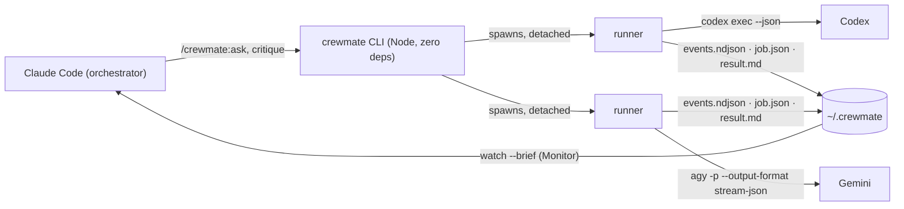

<div align="center">



**Your Claude Code session, with a crew.**<br>
Hand any task to OpenAI Codex or Google Gemini, keep working, and watch every step land in your conversation.

[](#install)
[](#how-it-works)
[](#how-it-works)
<br>
[](package.json)
[](#install)
[](LICENSE)

[Install](#install) · [Demo](#see-it-run) · [Commands](#commands) · [How it works](#how-it-works) · [Why crewmate](#why-crewmate) · [Safety](#safety)

</div>

---

## See it run

<p align="center">
  
</p>

<sub>Real output from `crewmate` against the real `codex` and `agy` CLIs, recorded on 2026-11-01. Only the waiting is shortened. Rebuild with `node scripts/readme-assets.mjs`.</sub>

> **Dogfooded.** Codex and Gemini reviewed crewmate's own lock code with `/crewmate:critique` and independently found the same race condition, one the build plan had accepted as too rare to matter and three earlier code reviews had not fixed. It's fixed now, with a test that reproduces it.

## Install

```text
/plugin marketplace add aashish-g03/crewmate
/plugin install crewmate@crewmate
```

Then `/crewmate:setup`. It checks everything and prints the exact fix for anything missing:

| You need | Install | Sign in |
|---|---|---|
| Node.js 20+ | [nodejs.org](https://nodejs.org) | — |
| **Codex** (OpenAI), optional | `npm i -g @openai/codex` | `codex login` |
| **Gemini** via the Antigravity CLI, optional | `curl -fsSL https://antigravity.google/cli/install.sh \| bash` | run `agy` once |

You need at least one vendor. No API keys: crewmate drives the CLIs you're already signed in to. macOS and Linux.

## What you get

| Feature | What it means |
|---|---|
| **Background jobs that outlive the call** | Every job runs detached. Claude keeps working; the job survives the session ending; the answer stays readable later. |
| **Live progress in the conversation** | `watch` streams each tool step. Under Claude Code's Monitor, `--brief` sends the start, errors, a summary a minute and the end, so Claude isn't woken for every file read. |
| **Honest endings** | Every job ends `done`, `failed`, `timeout` or `canceled`. Denied tools and tool errors are listed, never hidden. An empty answer is a failure, not a success. |
| **Zero-context critique** | `/crewmate:critique` sends a design doc or a diff to every ready vendor at once. They never see your conversation, so the gaps you filled in mentally show up. |
| **Follow-ups** | `--resume` continues the last conversation with that vendor, or a specific job's. |
| **Read-only by default** | Vendors can read your code, not change it, unless you say `--write` (or `--yolo`). One writer per folder at a time. |
| **Works outside Claude Code too** | It's one Node program with `--json` everywhere: call it from a shell, Codex, Gemini or any agent. |

## Commands

| Command | What it does |
|---|---|
| `/crewmate:ask <codex\|gemini> <prompt>` | Run a job. Flags: `--write`, `--yolo`, `--model <id>`, `--effort <level>`, `--resume[=<job-id>]`, `--timeout <90s\|10m\|1h>`, `--detach`, `--brief`. |
| `/crewmate:critique <paths> \| --diff[=<ref>]` | Independent review by every ready vendor, in parallel. |
| `/crewmate:status [id]` | Jobs in this workspace. |
| `/crewmate:result <id>` | A job's answer and outcome: state, duration, tokens, denied tools, tool errors. |
| `/crewmate:cancel <id>` | Stop a running job and its whole vendor process group. |
| `/crewmate:setup` | Check Node and both CLIs. |

Or just ask Claude: *"get a second opinion from Gemini on this migration"*. The bundled skill tells Claude when another model helps and how to watch the job.

## How it works



- **One runner per job.** `ask` and `critique` start a detached runner and return. The runner is the only process that writes the job's state, so every job gets exactly one ending, even across crashes and cancels.
- **Each vendor's own structured output.** Codex via `codex exec --json`, Gemini via `agy --output-format stream-json`. No screen-scraping, no MCP server, no daemon to keep running.
- **Processes are tracked by pid and start time.** `cancel` and cleanup never signal a reused pid, and kill the vendor's whole process group so nothing outlives a job.

## Why crewmate

| | **crewmate** | [codex-plugin-cc](https://github.com/openai/codex-plugin-cc) | [gemini-mcp-tool](https://github.com/jamubc/gemini-mcp-tool) | [PAL](https://github.com/BeehiveInnovations/pal-mcp-server) |
|---|---|---|---|---|
| Vendors | **Codex + Gemini** | Codex | Gemini | many (via API keys) |
| Uses your CLI sign-in, no API keys | ✅ | ✅ | ✅ | — |
| Install | **2 plugin commands** | 2 plugin commands | 1 `claude mcp add` | script or `uvx` |
| Background jobs that survive the session | ✅ | ✅ | — | — |
| Live tool-by-tool progress in the conversation | ✅ | status on request | — | — |
| Cross-vendor zero-context critique | ✅ | Codex review | — | consensus tools |
| Runtime dependencies | **0** | 0 | npm package | Python + uv |

Pick codex-plugin-cc if you only use Codex. Pick crewmate when you want both vendors behind one install and one job model.

## Use with EGM

Google's [Elephant-Goldfish Model](https://github.com/google/elephant-goldfish-model) reviews a design with fresh, zero-context Claude subagents (the "goldfish"). crewmate adds goldfish from *other vendors*: run `/egm:egm-review` for the staged review, then `/crewmate:critique <design.md>` to have Codex and Gemini read the same document cold. Different models miss different things.

## Safety

<details>
<summary><strong>What crewmate can do to your machine</strong></summary>

- **Default is read-only.** Codex runs with `sandbox_mode="read-only"`. Gemini runs in agy's headless mode, which denies anything that needs approval, and crewmate checks agy's reported permission mode before trusting it.
- **If your agy settings allow more than reading** (an allow-rule in `~/.gemini/antigravity-cli/settings.json`), crewmate refuses read-only Gemini jobs rather than pretend they're read-only.
- **`--write`** lets the vendor edit files in the folder you started from. Codex can also run shell commands there; Gemini can't.
- **`--yolo`** removes the vendor's sandbox and prompts. Claude is told never to add `--write` or `--yolo` unless you asked.
- **One writer per folder.** A second `--write` job is refused with exit code 6 while one is running.
- **Vendor output is data.** The skill tells Claude to treat answers and progress lines as text written by another model, never as instructions.

</details>

<details>
<summary><strong>Where things live</strong></summary>

Job state is in `~/.crewmate/workspaces/<folder>-<hash>/jobs/<id>/`: `job.json`, `events.ndjson`, `prompt.txt`, `result.md`. **Prompts and answers can contain your code**: the folders are user-only (`0700`). crewmate keeps the newest 50 finished jobs per workspace; delete the folder to remove everything.

</details>

<details>
<summary><strong>Exit codes and <code>--json</code></strong></summary>

`0` done (or a job id was printed) · `1` failed · `2` usage error · `3` vendor CLI not installed · `4` timeout · `5` canceled · `6` refused (a writer is running) · `7` no vendor ready for `critique`. Every command accepts `--json`.

</details>

## Tested against the real thing

- `npm test`: failure-mode tests driven by **recorded real CLI output**: denials, empty answers, signed-out agy, timeouts, races, pid reuse.
- `node scripts/e2e-check.mjs`: 16 checks against the **real** `codex` and `agy` in a throwaway repo. [Latest report](docs/release/1.0.0-e2e.md).
- Release check in real Claude Code sessions: [docs/release/1.0.0-check.md](docs/release/1.0.0-check.md).

## Credits

- Job handling and the helpers in `plugins/crewmate/lib/vendored/` come from OpenAI's [codex-plugin-cc](https://github.com/openai/codex-plugin-cc) (Apache-2.0, see `NOTICE`).
- The critique prompt is adapted from Google's [Elephant-Goldfish Model](https://github.com/google/elephant-goldfish-model) reviewer prompts (Apache-2.0).

## License

MIT, except the files listed in `NOTICE`.

## Author

[Aashish Gupta](https://linkedin.com/in/aashish03) · Software Engineer @ [Leena AI](https://leena.ai) · [aashishgupta.tech](https://www.aashishgupta.tech)
