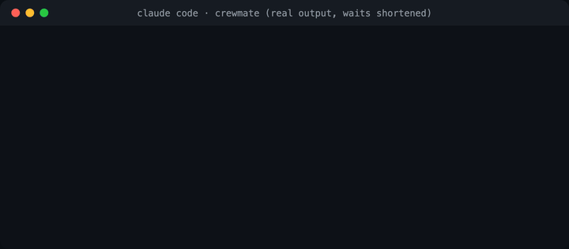

> **TL;DR** crewmate is a Claude Code plugin that lets Claude hand a task to OpenAI Codex or Google Gemini, keep working, and watch every step land in the conversation. It installs with **2 commands** and has **0 runtime dependencies**. It passes **16/16** checks against the real Codex and Gemini command-line tools, and **115** failure-mode tests. Asked to review crewmate's own lock code, **both** models found the same race condition, one my plan had accepted as too rare. If Codex is the only other model you use, OpenAI's own plugin is the better choice, and I say why below. Tested on macOS.
>
> [Code](https://github.com/aashish-g03/crewmate) | [End-to-end report](https://github.com/aashish-g03/crewmate/blob/main/docs/release/1.0.0-e2e.md) | [Release check in real Claude Code sessions](https://github.com/aashish-g03/crewmate/blob/main/docs/release/1.0.0-check.md)



---

## "Ask the other model"

You know the move. Claude wrote something you're unsure about, so you open another terminal and paste it into Codex or Gemini. You wait, copy the answer back, and paste it into Claude.

The second opinion is often worth it. The copy-paste isn't. I wanted Claude to do that hand-off itself: give the task to another model's agent, keep working, see progress as it happens, and get an answer it can trust, including when the other agent fails.

## The first version didn't work

crewmate v0.2 used folders as a mailbox, a pool of worker processes, an MCP server (Claude Code's tool-server protocol) and a helper subagent. Tasks went in and answers came out, but:

- **You saw nothing while a job ran.** Progress stayed inside the helper subagent; Claude Code only shows a subagent's final message.
- **Tasks silently stalled** unless `crewmate up` was running in another terminal.
- **Installing took 7 commands**, and a failed task was reported as "completed".


## What I built instead

I copied the packaging of [OpenAI's codex-plugin-cc](https://github.com/openai/codex-plugin-cc), plus four of its helper files (credited in the repo):

- **One plugin, two commands to install.** The repo is its own plugin marketplace.
- **One small Node program, zero dependencies.** No MCP server, nothing to `npm install`.
- **Every job runs as a detached background process.** Claude keeps working, the job outlives the session, and the answer stays readable later.
- **Each tool's own structured output.** Codex through `codex exec --json`. Gemini through [Antigravity](https://antigravity.google), Google's agent CLI (`agy`), with `--output-format stream-json`.
- **Read-only unless you say otherwise.** Jobs can read your code. `--write` lets them edit the folder, and only one writing job runs at a time.


The command I use most is `critique`. It sends a design doc or a diff to every installed, signed-in vendor at once, and neither sees my conversation. The idea comes from the [Elephant-Goldfish Model (EGM)](https://github.com/google/elephant-goldfish-model), an open-source review plugin from Google engineers (not an official Google product). A "goldfish" reviewer without your context finds the gaps you filled in mentally. crewmate's goldfish come from other vendors.


## Claude decides when to use it

No slash command needed. I asked Claude in plain words: *"I want a second opinion from a different model than you: does add.js handle string inputs safely? Get Gemini's view, then tell me where you agree or disagree."* The tool calls from that real session, trimmed:

```text
Skill   crewmate:crewmate
Bash    crewmate ask gemini --detach <<'CREWMATE_PROMPT' … CREWMATE_PROMPT
Bash    crewmate watch --brief gemini-mvxp4oxz-o0o6
Bash    crewmate result gemini-mvxp4oxz-o0o6
```

I named the vendor; Claude chose the tool, wrote Gemini's brief, watched the job, ran its own Node check and compared the two answers. The slash commands are just shortcuts for me.

## How I tested it

I don't trust tests that restate the code, so each layer drives something real:

| Layer | What it runs | Result |
|---|---|---|
| Failure-mode tests | the real CLI against fake vendors that replay **recorded real output** (plus a few hand-edited recordings for cases that are hard to trigger) | **115** passing |
| End-to-end script | the real Codex and Gemini tools in a throwaway git repo: ask, resume, read-only, write with lock, cancel, critique | **16/16** |
| Real sessions | the plugin installed from GitHub, driven by real Claude Code | [release check](https://github.com/aashish-g03/crewmate/blob/main/docs/release/1.0.0-check.md) |

Before any code, the design went through an EGM review: five zero-context reviewers and a sixth that weighed their reports. It found **no blockers** but 13 major issues. Fixing them made the design smaller: one way to talk to Codex instead of two, and one runner for every job.

## The result: the bug two models agreed on

Late in the build I ran `/crewmate:critique` on crewmate's own lock code, the part that keeps two writing jobs from editing your files at once. Codex and Gemini **both** flagged the same race:


My plan had accepted that race as too rare to matter. Codex even quoted that line of the plan back at me. Two models that never saw my conversation decided it mattered anyway. The fix serializes the takeover, and a test reproduces the race with staggered pauses. That's the second opinion I built crewmate to get.

## What didn't work

Each of these only showed up against the real tools:

- **Gemini's plan mode turned questions into plans.** Asked what a file does, it replied *"I have reviewed add.js and prepared an implementation plan for your request."* Read-only runs now use agy's default non-interactive mode. *(Real run.)*
- **agy gives up after a denied tool.** Read-only, it tried `ls`, was denied, and ended with an empty answer marked `SUCCESS`. crewmate counts an empty answer as a failure and continues the conversation once with "use your file tools". In a by-hand rerun, that recovered a real answer. *(Release check in Claude Code.)*
- **agy's permission report can't be trusted alone.** An allow-rule in my agy settings let it write a file while still reporting `request-review`. Read-only Gemini jobs now refuse to start when your user-level agy settings allow more than reading. *(Final code review.)*
- **Live progress can be too live.** Claude Code's Monitor tool turns each output line into a message, so a critique of a long design doc woke Claude about **55** times. `watch --brief` sends the start, errors, one summary a minute and the end; the next critique took **7** turns. *(Real Claude Code session.)*
- **"Did not respond" was wrong for deep thinkers.** Codex at high effort can go past 45 seconds before its first visible step, which tripped my 45-second check. Its first event now counts. *(Final code review.)*

## What I learned

- **Record the real tools first.** Every item above came from real output, and the recordings became the tests.
- **"Done" needs a definition.** Exit code 0 with an empty answer is not done.
- **Different models catch different things,** but only when they get the work without your reasoning attached.

## Why not just OpenAI's plugin?

If Codex is the only other model you use, install [codex-plugin-cc](https://github.com/openai/codex-plugin-cc). It's built on Codex's own app server, and has a Codex-specific review mode and a hand-off into a native Codex session. crewmate is for running **both** Codex and Gemini behind one install and one job model.

## Try it

- **In Claude Code:** `/plugin marketplace add aashish-g03/crewmate`, then `/plugin install crewmate@crewmate`, then `/crewmate:setup`. You need Node 20+ and at least one of `codex` or `agy`, installed and signed in.
- **Ask in plain words:** "get a second opinion from Codex on this migration" or "have Gemini read the whole repo and list dead exports".
- **Critique your own design:** `/crewmate:critique docs/design.md`, or `/crewmate:critique --diff` before you commit.
- **Reproduce the numbers:** `npm test` and `node scripts/e2e-check.mjs` in the repo.

Next: more vendors behind the same job model, and a fallback when one hits its quota. If you try it, tell me where the second opinion surprised you.

---

*AI disclosure: I built crewmate with Claude Code as the implementer, working from a design and plan I directed and approved, with Codex, Gemini and fresh Claude reviewers checking the work. This post was drafted with Claude and edited by me. The numbers come from the reports and recordings in the repo, and every terminal frame is real output.*
