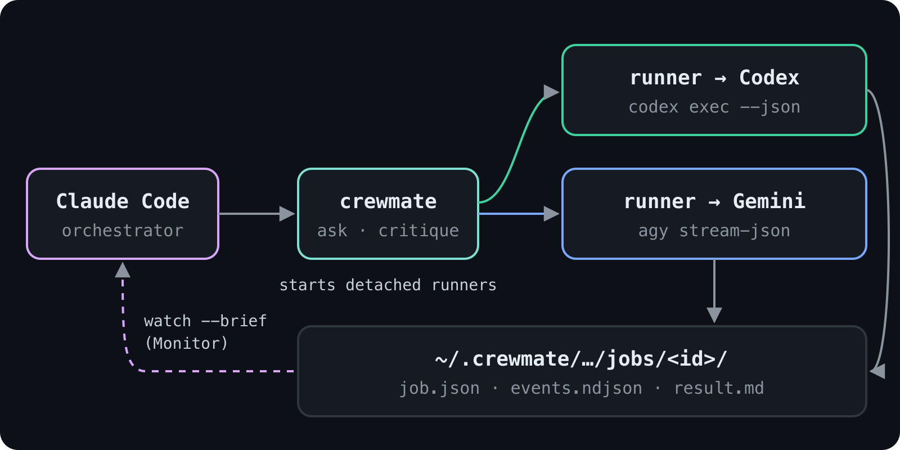
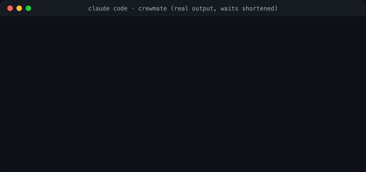
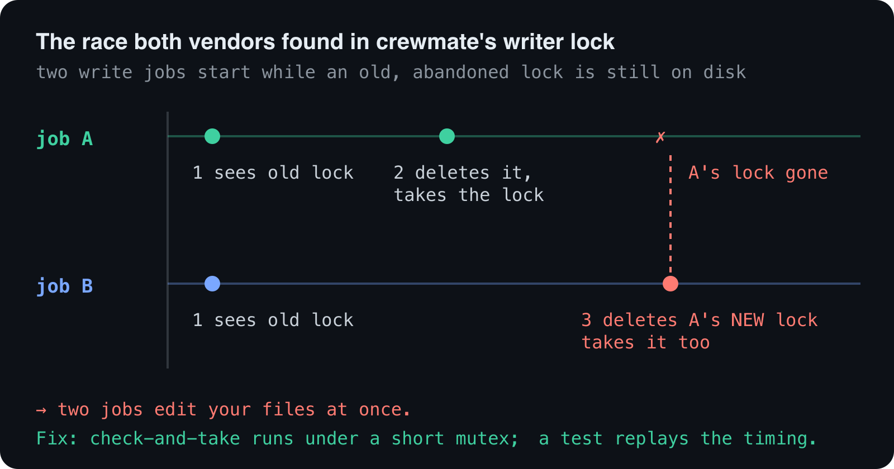

> **TL;DR** crewmate is a Claude Code plugin that lets Claude hand a task to OpenAI Codex or Google Gemini, keep working, and watch every step land in the conversation. It installs with **2 commands** and has **0 dependencies**. When I asked it to review its own code, **both** models found the same race condition, one I had decided was too rare to matter. If Codex is the only other model you use, OpenAI's own plugin is the better choice; more on that below.
>
> [Code](https://github.com/aashish-g03/crewmate) | [Try it](#try-it)


---

## "Ask the other model"

You know the move. Claude wrote something you're unsure about, so you open another terminal and paste it into Codex or Gemini. You wait, copy the answer back, and paste it into Claude.

The second opinion is often worth it. The copy-paste isn't. I wanted Claude to make that hand-off itself, and I wanted three things from it:

- **See progress** while the other model works, not just a final blob.
- **Nothing to babysit:** no server or extra terminal to keep running.
- **Know how it really ended:** done, failed, timed out, or canceled, and why.

## What it does

- **Hand off and keep working.** Each job runs in the background. Claude carries on, and the answer is waiting when the job ends, even if you closed the session.
- **Live progress in the chat.** Every file read, command and note shows up as it happens.
- **Clear endings.** A job ends `done`, `failed`, `timeout` or `canceled`, with the reason and any tools the other model was denied.
- **Read-only unless you say so.** The other model can read your code. Add `--write` and it can edit the folder; only one writing job runs at a time.
- **Follow-ups.** `--resume` continues the last conversation with that model.
- **Zero-context critique.** `/crewmate:critique` sends a design doc or a diff to both models at once, and neither sees your conversation.



That last one is the command I use most. A reviewer who hasn't seen your reasoning finds the gaps you filled in mentally, and two different models find different gaps.



## Claude decides when to use it

You don't need a slash command. I asked Claude in plain words: *"I want a second opinion from a different model than you: does add.js handle string inputs safely? Get Gemini's view, then tell me where you agree or disagree."*

Claude picked up crewmate on its own:

```text
Skill   crewmate
Bash    crewmate ask gemini --detach <<'PROMPT' … PROMPT
Bash    crewmate watch --brief gemini-mvxp4oxz-o0o6
Bash    crewmate result gemini-mvxp4oxz-o0o6
```

It wrote Gemini's brief, watched the job, checked the answer itself, and told me where the two agreed. An agent orchestrating a bigger task can hand work to Codex or Gemini the same way, without waiting for you.

## The bug two models agreed on

Late in the build, I ran `/crewmate:critique` on crewmate's own lock: the code that stops two writing jobs from editing your files at once. Codex and Gemini **both** flagged the same race.



I had decided that race was too rare to matter, and written that down in my plan. Codex quoted the line back at me. It's fixed now. That's the second opinion I built crewmate to get.

## What it won't do

- **Gemini can't run shell commands** in read-only jobs; it reads files instead. With `--write` it can edit files, but still no shell.
- **If your Gemini (agy) settings allow writes or commands,** crewmate refuses read-only Gemini jobs rather than pretend they're read-only.
- **macOS is what I've tested on.** Linux should work; Windows isn't supported yet.

## Why not just OpenAI's plugin?

If Codex is the only other model you use, install [codex-plugin-cc](https://github.com/openai/codex-plugin-cc): it's built on Codex's own app server and has extras like a hand-off into a native Codex session. crewmate is for having **both** Codex and Gemini behind one install.

## Try it

**1. Install** (in Claude Code):

```text
/plugin marketplace add aashish-g03/crewmate
/plugin install crewmate@crewmate
/crewmate:setup
```

`/crewmate:setup` checks everything and tells you exactly what's missing. You need Node 20+ and at least one of these, installed and signed in:

```bash
npm i -g @openai/codex && codex login                                # Codex
curl -fsSL https://antigravity.google/cli/install.sh | bash && agy   # Gemini (Antigravity CLI)
```

**2. Use it:**

```text
/crewmate:ask gemini Read src/ and list any exported functions nothing uses
/crewmate:critique --diff
```

Or just ask Claude: *"get a second opinion from Codex on this migration."*

Next on my list: more models behind the same commands, and falling back to another model when one runs out of quota. If you try it, tell me where the second opinion surprised you.

---

*AI disclosure: I built crewmate with Claude Code as the implementer, working from a design and plan I directed and approved, with Codex, Gemini and fresh Claude reviewers checking the work. This post was drafted with Claude and edited by me. Every terminal frame is real output.*
